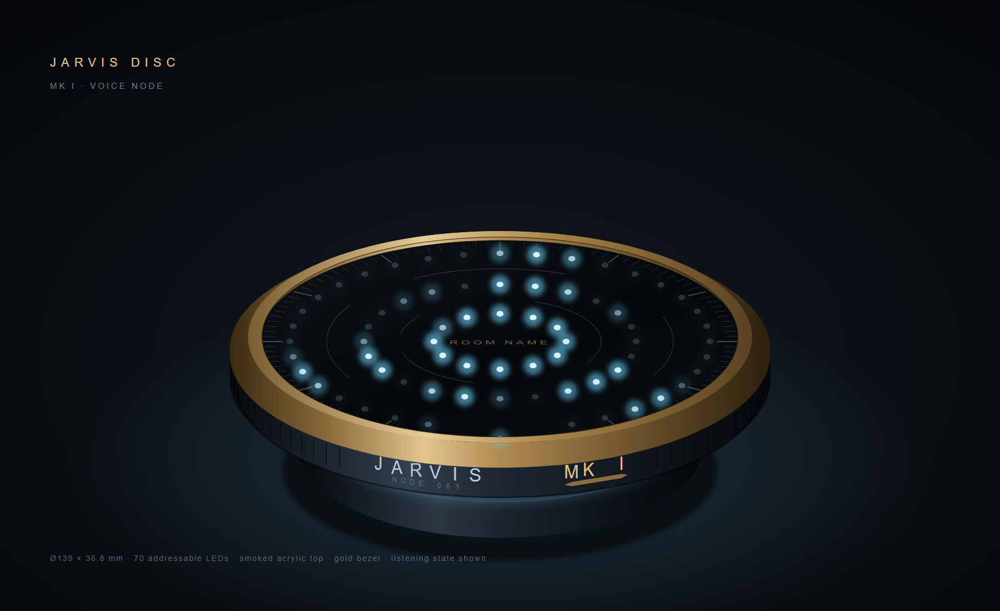

# Jarvis Disc — State Illustrations

## What this is

The official visual identity pack for the **Jarvis Disc Mk I** — a set of SVG/PNG illustrations showing the disc in each of its LED communication states:

| File | State |
|---|---|
| `jarvis-disc-illustration-idle.svg/.png` | **Idle** — resting glow, listening for the wake word |
| `jarvis-disc-illustration-listening.svg/.png` | **Listening** — capturing speech |
| `jarvis-disc-illustration-thinking.svg/.png` | **Processing** — audio is on the server, Jarvis is thinking |
| `jarvis-disc-illustration-speaking.svg/.png` | **Speaking** — playing a synthesized response |
| `jarvis-disc-illustration-muted.svg/.png` | **Muted** — hardware mic cut, device deaf by switch |
| `jarvis-disc-illustration.svg/.png` | Master artwork (speaking-state variant) |
| `jarvis-disc-illustrations.zip` | Full bundle of all rendered PNGs from the source set |

The SVGs are the editable masters; the PNGs are 1800×1100 renders.

## Why it exists

Jarvis is being built as a centralized, always-on personal AI running on a dedicated
Ubuntu server (Ryzen 7 / RTX 3090, llama.cpp inference host, MQTT + WebSocket device
network). The **Disc is how that server gets out of the rack and into the house**: a
cheap, dumb, network-connected voice and media endpoint placed room by room.

Each disc runs no intelligence of its own. It captures two INMP441 microphones, streams
audio to the server over Wi-Fi (ESP32-S3 / XIAO), plays TTS and music through a MAX98357A
amp, and — crucially — **communicates its state back to the people in the room through
light**. 70 addressable LEDs on the main ring plus a 17-LED seam strip, under a smoked
acrylic top with a gold bezel, render exactly the states illustrated here.

These illustrations define that state vocabulary. They are the design reference for the
firmware's local LED animation engine and the visual language the eventual product
documentation, dashboards, and marketing will use.

The physical privacy mute state is included deliberately: a light you can always read
tells you, at a glance from across the room, whether the disc can hear you.

## Status

Design asset only. Firmware and server integration live elsewhere in the Jarvis project.
